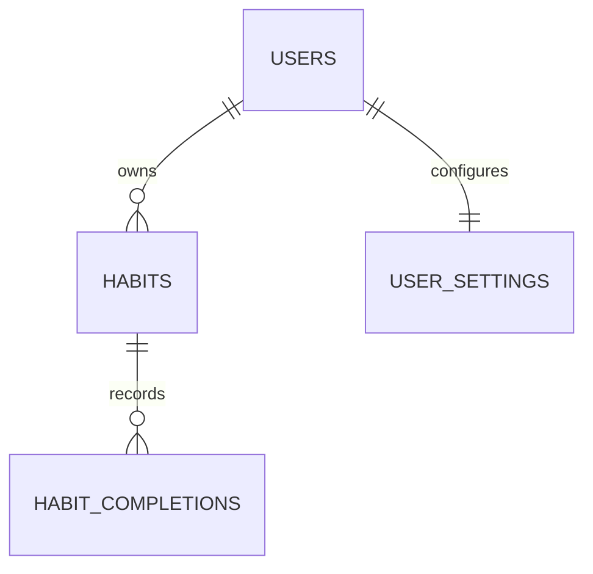

# Database Design — Habit Tracker

## Entities
### users
- `id UUID PK`
- `email VARCHAR(254) UNIQUE NOT NULL`
- `password_hash TEXT NOT NULL`
- `display_name VARCHAR(80)`
- `timezone VARCHAR(64) NOT NULL`
- `created_at`, `updated_at TIMESTAMPTZ NOT NULL`

### habits
- `id UUID PK`
- `user_id UUID FK users(id) NOT NULL`
- `name VARCHAR(80) NOT NULL`
- `description VARCHAR(500)`
- `color VARCHAR(24)`
- `icon VARCHAR(40)`
- `schedule_type VARCHAR(20) NOT NULL` (DAILY, WEEKDAYS, CUSTOM)
- `schedule_days SMALLINT[]` (1=Monday ... 7=Sunday; validate in service)
- `start_date DATE NOT NULL`
- `archived_at TIMESTAMPTZ NULL`
- `created_at`, `updated_at TIMESTAMPTZ NOT NULL`

### habit_completions
- `id UUID PK`
- `habit_id UUID FK habits(id) NOT NULL`
- `local_date DATE NOT NULL`
- `completed BOOLEAN NOT NULL`
- `completed_at TIMESTAMPTZ NULL`
- `created_at`, `updated_at TIMESTAMPTZ NOT NULL`
- UNIQUE (`habit_id`, `local_date`)

### user_settings
- `user_id UUID PK/FK users(id)`
- `week_starts_on SMALLINT NOT NULL`
- `reminders_enabled BOOLEAN NOT NULL DEFAULT FALSE`

## Relationships
User 1—N Habits; Habit 1—N Completions; User 1—1 Settings.

## Indexes
- `users(email)` unique.
- `habits(user_id, archived_at)`.
- `habit_completions(habit_id, local_date)` unique.
- Optional composite indexes only after query plans show need.

## Integrity
- Cascade deletion policy must be explicit and tested.
- A habit completion must belong to a habit owned by the authenticated user.
- Use UTC timestamps and `DATE` for local habit dates.
- Use Flyway migration files; never edit an already-applied migration in shared environments.

## ERD

